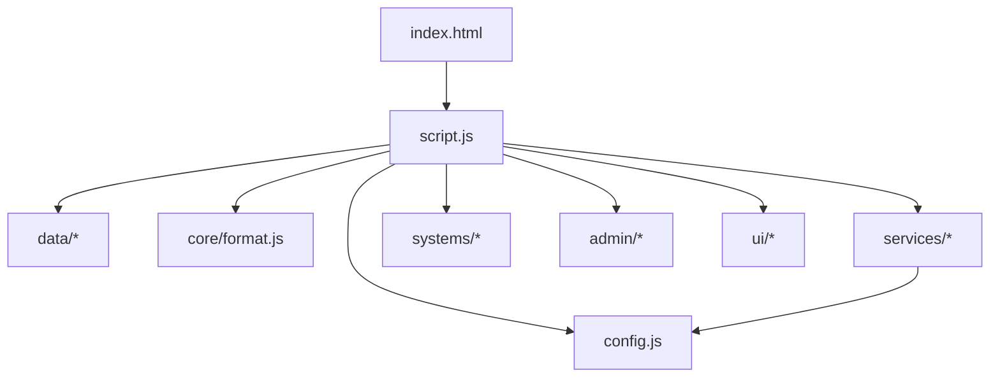

# Frontend ES Module Map

Status: eighth extraction pass, centralized interval/timeout management, lifecycle regression hardening, and user-led browser regression; the current tree contains 44 JavaScript files. `script.js` is a 284-line application composition root. The dice and pet systems remain the only feature modules above 300 lines; their shared state boundaries are documented below.

## Entry point

- `index.html` loads `script.js` using `<script type="module">`.
- The application uses browser-native ES Modules and relative imports. No bundler or new runtime dependency was added.
- Existing inline event-handler attributes were removed from the pet-sale modal; its actions are registered by `ui/pet-selling.js`.

## Current module tree

```text
index.html
└── script.js (284 lines) — application composition root and remaining startup bindings
    ├── config.js
    ├── data/
    │   ├── dice.js
    │   ├── equipment.js
    │   ├── pets.js
    │   └── progression.js
    ├── core/
    │   ├── format.js
    │   ├── game-state.js (42 lines)
    │   └── timer-manager.js — shared interval registry with per-module scopes and cleanup
    ├── services/
    │   ├── supabase.js
    │   ├── device-lock.js
    │   ├── visit-tracking.js
    │   ├── cloud-save.js
    │   ├── auth.js
    │   ├── presence.js
    │   ├── activity-logs.js
    │   └── account-actions.js
    ├── systems/
    │   ├── coin-boost.js
    │   ├── dice.js (399 lines)
    │   ├── global-boost.js
    │   ├── leaderboards.js
    │   ├── pet-income.js
    │   ├── pet-skills.js
    │   ├── pets.js (488 lines)
    │   ├── progression.js
    │   ├── realm-social.js (composition facade)
    │   ├── global-announcements.js (185 lines)
    │   ├── realm-polls.js (206 lines)
    │   └── weather.js
    ├── admin/
    │   ├── grants.js
    │   ├── pet-odds.js
    │   ├── player-management.js (49 lines)
    │   ├── monitoring.js (36 lines)
    │   └── ui-bindings.js (28 lines)
    ├── ui/
        ├── equipment.js (composition facade)
        ├── gloves.js (218 lines)
        ├── potions.js (249 lines)
        ├── codex.js
        ├── main-render.js (65 lines)
        ├── inventory.js (227 lines)
        ├── pet-notices.js
        ├── navigation.js
        ├── pet-selling.js
    └── tests/
        └── lifecycle-regression.test.js
```

## Dependency direction

The exhaustive named-function ownership reconciliation against the pre-extraction `script.js` baseline is documented in [`FRONTEND_FUNCTION_OWNERSHIP.md`](./FRONTEND_FUNCTION_OWNERSHIP.md).



Most extracted systems and UI modules receive their dependencies through factory/setup arguments. This avoids importing the application entry point back into feature modules and prevents a circular import graph.

## Initialization lifecycle

Factory setup methods that attach long-lived delegated listeners or recurring work are guarded against repeated initialization. This includes Auth state subscription registration, visit tracking, auto-roll UI, global-boost UI, realm-poll UI, codex UI, glove/potion UI and pet UI. Auth exposes an explicit unsubscribe method; visit tracking exposes `stopGameVisitTracking()` to remove its visibility listener and heartbeat scope. Weather's player-specific realtime subscription replaces the previous channel when the signed-in user changes, and global announcements avoid opening a second channel while one is already registered. These guards prevent repeated setup calls from multiplying handlers or recurring work; they do not replace a full page/application teardown contract.

## Timer ownership

`script.js` creates one `createTimerManager()` instance and injects it into modules that own recurring or delayed work. All application `setInterval`, `setTimeout`, `clearInterval` and `clearTimeout` operations use this manager; one-shot timers are assigned named scopes and replaceable timers retain their handles for cancellation. Interval scopes include `presence-heartbeat`, `device-lock-heartbeat`, `visit-tracking`, `pet-income`, `weather-ui`, `weather-refresh`, `global-boost-refresh`, `realm-activity-render`, `admin-income-monitor`, `realm-poll-countdown`, `realm-poll-sync`, `auto-roll`, and `potion-expiry`. Timeout scopes include `toast-hide`, `auth-signout`, `auth-visit-record`, `auth-session-init`, `auth-cloud-load-timeout`, `device-lock-idle-unlock`, `device-lock-acquire-timeout`, `cloud-save-debounce`, `cloud-save-flush-wait`, `dice-reveal-delay`, `dice-roll-processing`, `dice-special-note`, `dice-roll-settle`, `achievement-popup-queue`, `pet-auto-sell-notice`, `weather-surge-overlay`, and `realm-announcement-hide`. The manager exposes `clearScope`, `clearAll` and `getStats` for lifecycle cleanup and diagnostics.

Replaceable one-shot timers clear their predecessor before scheduling a replacement. Their owning handle is nulled when the callback fires, preventing stale handles from being treated as pending work. Achievement popup handoff cancels its pending callback when a new item arrives during the handoff window; weather surge replacement cancels the removed overlay's cleanup timeout. Cloud-save sync cancels any pending debounce before a direct sync and clears the debounce handle as soon as it fires.

## Remaining responsibilities in `script.js`

The remaining composition-root responsibilities are:

- Importing feature/data modules and constructing services in dependency order.
- Owning shared in-memory state references (`S`, `currentUser`) and passing getters/setters to module factories.
- Keeping compatibility wrappers for cross-module calls such as cloud-save, realm announcements, equipment rendering and admin actions.
- Defining small shared gameplay helpers (`byId`, `totalDice`, potion/stat calculations and `toast`).
- Wiring the remaining top-level controls, account actions, admin bindings and application startup.

At the current snapshot, `script.js` is 284 lines, and the project contains 44 JavaScript files. Game-state creation, legacy migration, normalization, auto-sell preference persistence, local save, player presence, activity logs, account actions, pet-sale notices, codex rendering, main-page render orchestration, inventory sale and bag-capacity calculations live in focused modules. Auth lifecycle and cloud-save operations are implemented in `services/auth.js` and `services/cloud-save.js`; the entry point composes them and retains compatibility wrappers. The realm social and equipment features are divided into announcement/poll and glove/potion modules; their original entry modules act as small composition facades. Two feature modules remain above 300 lines: `systems/dice.js` (399) and `systems/pets.js` (488). They retain shared dice-roll/timer state and shared pet ownership/skill/crafting state respectively; further splitting needs a separately designed state boundary to avoid duplicating timers or pet-state mutation. `data/pets.js` is a catalogue/data file and is treated separately from feature modules.

## Validation performed

- All 44 JavaScript files passed `node --check` in the current worktree.
- Node ES Module import and factory smoke tests passed for `admin/player-management.js`, `admin/monitoring.js`, `ui/equipment.js`, `ui/gloves.js`, `ui/potions.js`, `systems/realm-social.js`, `systems/global-announcements.js`, and `systems/realm-polls.js`.
- Static search confirms the extracted admin, realm-social, glove and potion implementations no longer remain duplicated in `script.js`; the entry point retains composition, wrappers, shared helpers, remaining top-level event bindings and initialization.
- `git diff --check` exited 0.
- User-led real-browser regression passed: homepage/module initialization, login/logout and cloud mode, manual/automatic dice rolls and inventory sale, gloves/potions/weather, pets/achievements/daily quests, and leaderboard. The admin page could not be verified because the test account has no administrator permission; this is an access limitation, not a passing admin-page test. Live GitHub Pages verification remains outstanding.
- This task is exempt from Supabase CSV inspection; no SQL Editor query, Supabase schema change or remote deployment was performed.
- All 14 application interval registration sites use the shared timer manager; static search found no direct `setInterval`／`clearInterval` calls outside `core/timer-manager.js`.
- Timer integration smoke test passed for eight module scopes, repeated setup, module-owned clearing, `clearScope` and `clearAll`.
- All application one-shot timeout registration and cancellation sites now use the same manager; auth and device-lock Promise.race timeout handles are cleared when the competing operation finishes first.
- One-shot timeout lifecycle integration test passed: achievement queue handoff race, weather overlay replacement, cloud-save debounce replacement/firing, pet notice handle cleanup and realm announcement handle cleanup.
- The current tree has 19 `timerManager.setTimeout` registration callsites after consolidating cloud-save debounce scheduling into one helper; static search finds zero native application timer calls outside `core/timer-manager.js`.
- `node --test tests/lifecycle-regression.test.js` passed seven regression tests covering Auth listener idempotency/unsubscribe, visit-tracking start/stop/restart, repeated setup for dice/global-boost/realm-poll/codex/glove/potion/pet UI, player-weather channel replacement, global-announcement channel idempotency, and timer firing/clear-all cleanup.
- Lifecycle guards are regression-tested in Node with fake DOM/timer dependencies. User-led browser checks covered the feature flows listed above; live Supabase Realtime delivery and GitHub Pages loading remain unverified.
- Current import graph check: 44 JavaScript files, 58 relative imports, all targets present, zero cycles. All 44 files pass `node --check`.
